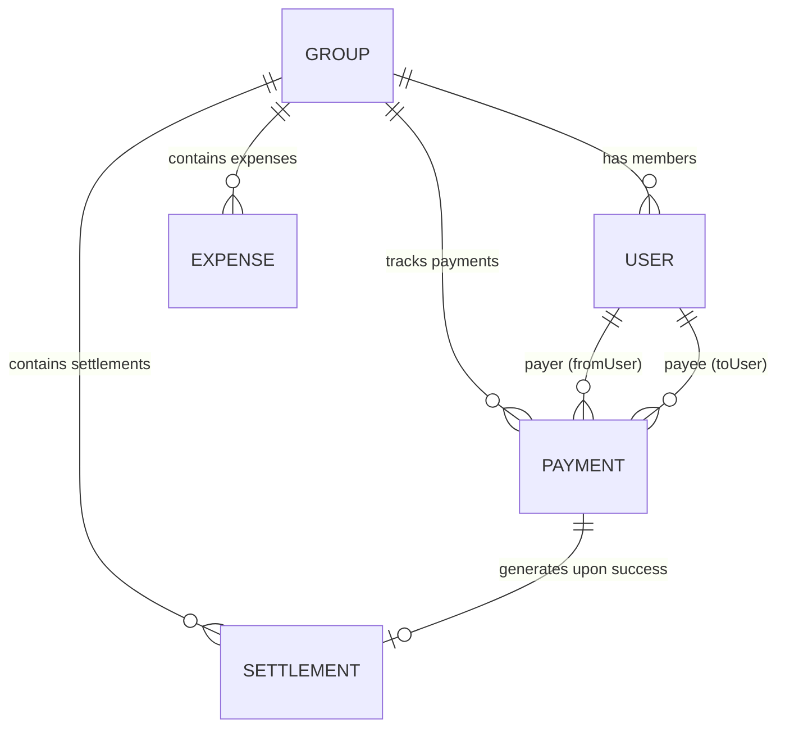

# 💳 Direct In-App Stripe Settlement Payment Lifecycle & Architecture

This document defines the formal state transitions, data structures, idempotency controls, balance impact, and verification rules for Stripe payments within the Expense Manager application.

---

## 1. State Machine & Lifecycle Transitions

Every Stripe settlement payment moves through a deterministic finite-state machine (FSM):

```
       [ Client initiates settlement ]
                     │
                     ▼
                 ┌────────┐
                 │ PENDING│  (Stripe PaymentIntent created with clientSecret)
                 └───┬────┘
                     │
         ┌───────────┴───────────┐
         ▼                       ▼
  ┌────────────┐           ┌───────────┐
  │ PROCESSING │           │ CANCELLED │ (Modal dismissed before confirmation)
  └──────┬─────┘           └───────────┘
         │
    ┌────┴─────────────────────────────┐
    ▼                                  ▼
┌───────────┐                    ┌───────────┐
│ SUCCEEDED │                    │  FAILED   │ (Card declined, 3DS failed, expired)
└─────┬─────┘                    └───────────┘
      │
      ▼
┌──────────────────────────────────────────────┐
│ SETTLEMENT CREATED & GROUP BALANCES UPDATED  │
│ (Dual-verification: Webhook or Status API)   │
└──────────────────────────────────────────────┘
      │
      ▼ (Optional future refund)
┌────────────┐
│  REFUNDED  │
└────────────┘
```

### Supported Status Definitions:
1. **`pending` (Initial State):**
   - Created when the user clicks "Pay with Stripe" and the backend creates a Stripe `PaymentIntent`.
   - Client receives the `clientSecret` and Payment record ID.
   - **Balance Effect:** `0`. Does **not** reduce debt or alter net balances.
2. **`processing`:**
   - Client submitted payment credentials (e.g. card, 3D Secure / OTP) to Stripe.
   - Awaiting authorization outcome.
   - **Balance Effect:** `0`. Does **not** reduce debt.
3. **`succeeded` (Final Positive State):**
   - Verified by Stripe webhook (`payment_intent.succeeded`) or direct server-side Stripe status retrieval.
   - Triggers automatic `Settlement.create()` transaction.
   - **Balance Effect:** Debt is permanently decreased by the settled amount. Group net balances are recalculated.
4. **`failed`:**
   - Card declined, insufficient funds, expired, or 3D Secure authentication failed.
   - **Balance Effect:** `0`. Debt remains untouched.
5. **`cancelled`:**
   - User closed the checkout modal or intent expired.
   - **Balance Effect:** `0`.
6. **`refunded`:**
   - Payment was reversed. Associated settlement can be marked as reversed if needed.

---

## 2. Mapping: Stripe Identifiers ↔ Internal Records

| Stripe Reference | Internal Model Field | Purpose |
| :--- | :--- | :--- |
| `pi_3M...` (`PaymentIntent.id`) | `Payment.stripePaymentIntentId` | Primary lookup key for webhook event correlation. Unique index enforced. |
| `ch_3M...` (`Charge.id`) | `Payment.receiptMeta.stripeChargeId` | Proof of charge for banking and receipts. |
| `client_secret` (`pi_..._secret_...`) | Ephemeral (returned to client) | Used only by `@stripe/react-stripe-js` to mount Stripe Elements. Never saved in DB. |
| `Payment._id` | `Settlement.paymentId` & `Payment.id` | Internal document ID linking payment to settled balance. |
| `Settlement._id` | `Payment.settlement` | Reciprocal reference once settlement is generated. |
| `RCP-YYYYMMDD-XXXX` | `Payment.receiptNumber` | Human-readable receipt identifier for audit logs and users. |

---

## 3. Relational Entity Diagram



Each `Payment` record explicitly links:
- `group`: Group ObjectId
- `payer` (`fromUser`): Authenticated user making the payment
- `payee` (`toUser`): Recipient user receiving funds
- `amount`: Strict decimal number (converted to cents/paise for Stripe)
- `currency`: 3-letter ISO code (`INR`, `USD`, `EUR`, `GBP`)
- `status`: `'pending' | 'processing' | 'succeeded' | 'failed' | 'cancelled' | 'refunded'`
- `idempotencyKey`: Unique string preventing duplicate PaymentIntents
- `stripePaymentIntentId`: Unique index in MongoDB

---

## 4. Balance Integrity & Protection Rules

### Rule 1: No Unverified Balances
> [!IMPORTANT]
> A pending or failed payment MUST NEVER be treated as a completed settlement. The net balance formula in `netBalanceService`:
> `netBalance = (totalPaid - totalOwed) + (settlementsPaid - settlementsReceived)`
> relies strictly on verified `Settlement` records.

### Rule 2: Server-Side Amount Authority
- The client cannot dictate an arbitrary settlement amount.
- The backend verifies that `amount <= debtor's outstanding net balance` before creating the Stripe `PaymentIntent`.
- The debtor cannot pay themselves (`payerId !== payeeId`).

### Rule 3: Idempotency & Duplicate Prevention
- **15-Second Duplicate Window:** Same payer, payee, amount within 15 seconds returns `409 Conflict`.
- **Database Unique Constraint:** `Payment.stripePaymentIntentId` has a MongoDB unique sparse index.
- **Webhook Replay Idempotency:** If `payment_intent.succeeded` webhook is delivered more than once, the handler checks if `payment.status === 'succeeded'` or if `Settlement` already exists for this `transactionId`. If so, it returns `{ received: true, duplicate: true }` without inserting a second settlement.

### Rule 4: Dual Asynchronous Confirmation (Webhook + Polling)
- **Primary:** Stripe Webhooks deliver `payment_intent.succeeded` directly to `/api/payments/webhook`.
- **Fallback / Real-Time Client Sync:** When the user completes 3D Secure or card entry in the modal, the client calls `GET /api/groups/:groupId/payments/:paymentId/status` or `POST /api/groups/:groupId/payments/verify`.
- Whichever pathway executes first completes the settlement atomically. The other pathway safely detects the completed state and exits without re-crediting.

---

## 5. Verified Transaction Receipts

Upon verified payment success:
1. An internal receipt reference is created (e.g. `RCP-20261024-A8F2`).
2. Receipt metadata contains:
   - `receiptNumber`: `RCP-...`
   - `amount`: Settled amount (e.g., `₹500.00`)
   - `currency`: Group base currency
   - `payer`: `{ id, name, email }`
   - `payee`: `{ id, name, email }`
   - `group`: `{ id, name }`
   - `stripePaymentIntentId`: Stripe identifier
   - `paymentMethod`: e.g. `'card'`
   - `confirmedAt`: Timestamp
3. The receipt is visible in the transaction ledger and accessible via `GET /api/groups/:groupId/payments/:paymentId/receipt`.
